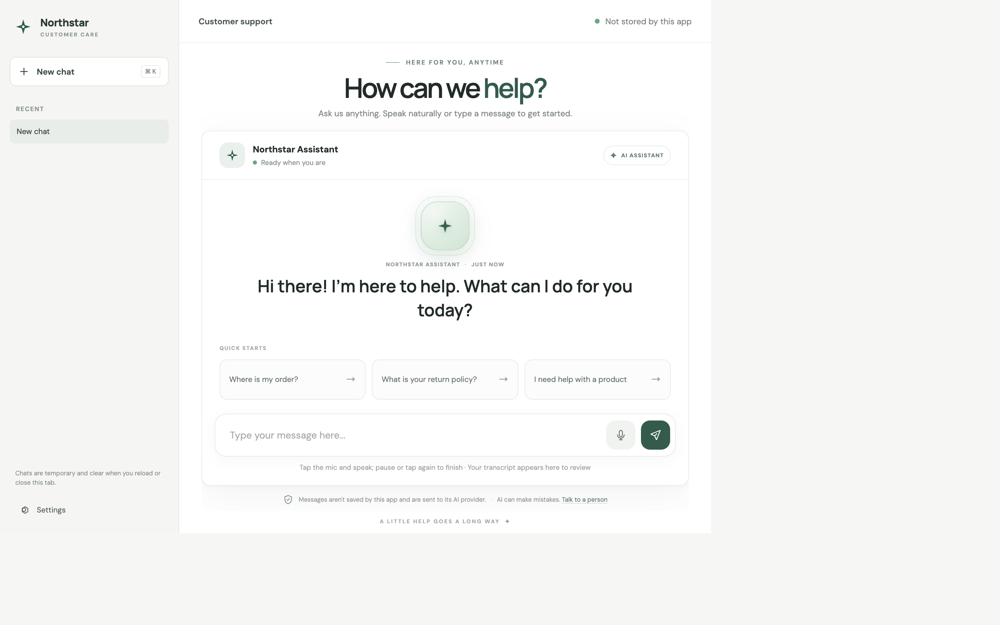

# Northstar Voice Assistant

<p align="center">
  
</p>

<p align="center">
  A polished, voice-first customer support chat with local speech transcription and AI-powered replies.
</p>

## Features

- **Speak or type:** Use the microphone or message box to ask for help.
- **Local speech transcription:** Recordings are transcribed on your device with Whisper.cpp.
- **Helpful AI replies:** Forward customer questions to an OpenAI-compatible chat-completions provider.
- **Temporary conversations:** Recent chats stay in the current tab and are cleared when it reloads or closes.
- **Read aloud:** Hear assistant replies in browsers that support speech synthesis.
- **Responsive interface:** Sidebar, settings, theme selection, and a compact mobile layout.
- **English replies:** The assistant responds in English regardless of the language used in the question.

## Run locally

### Requirements

- Node.js 20 or newer
- An OpenAI-compatible chat-completions provider
- macOS with Homebrew for the one-command Whisper setup

### Setup

1. Copy `.env.example` to `.env`.
2. Set `AI_API_KEY` and adjust `AI_BASE_URL` or `AI_MODEL` if needed.
3. Set `COMPANY_NAME` and `SUPPORT_CONTEXT` for your support team.
4. Install Whisper.cpp and download its speech model:

   ```sh
   npm run setup:speech
   ```

5. Start the app:

   ```sh
   npm start
   ```

6. Open [http://127.0.0.1:3000](http://127.0.0.1:3000).

The server binds to localhost by default. Keep `.env` private; it is excluded from Git.

### Use a local model

For an OpenAI-compatible local server such as Ollama, set the following in `.env`:

```env
AI_BASE_URL=http://localhost:11434/v1
AI_MODEL=your-installed-model
AI_API_KEY=ollama
```

### Configure speech manually

On systems without Homebrew, install `whisper-cli` and a compatible Whisper.cpp model yourself. Set `WHISPER_CLI` if the executable is not on `PATH`, or `WHISPER_MODEL` if the model is not at `.models/ggml-tiny.bin`.

## Privacy

Microphone audio is sent to this app's local server for transcription. Raw recordings are deleted after transcription; the resulting text is sent to the configured AI provider when submitted. The app does not save conversations between page reloads, though the AI provider's own data-retention policies may apply.

## Configuration

| Variable | Purpose |
| --- | --- |
| `AI_API_KEY` | API key for the configured chat provider |
| `AI_BASE_URL` | Provider API base URL |
| `AI_MODEL` | Model name sent to the provider |
| `COMPANY_NAME` | Name shown in the app and assistant prompt |
| `SUPPORT_CONTEXT` | Support policies and guidance for the assistant |
| `PORT` | Local server port (default: `3000`) |
| `WHISPER_CLI` | Optional path or command for `whisper-cli` |
| `WHISPER_MODEL` | Optional path to the Whisper model |

Only use approved public support information in `SUPPORT_CONTEXT`. The assistant is instructed not to invent customer-specific order information or policies.

## Verify

Run the test suite:

```sh
npm test
```
